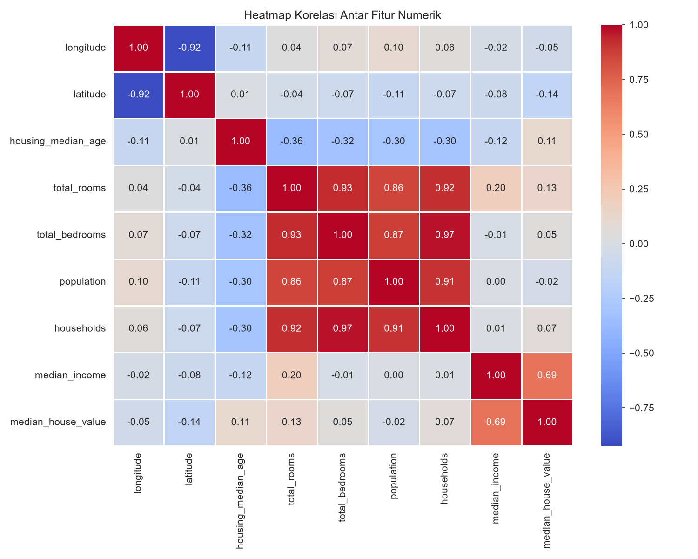
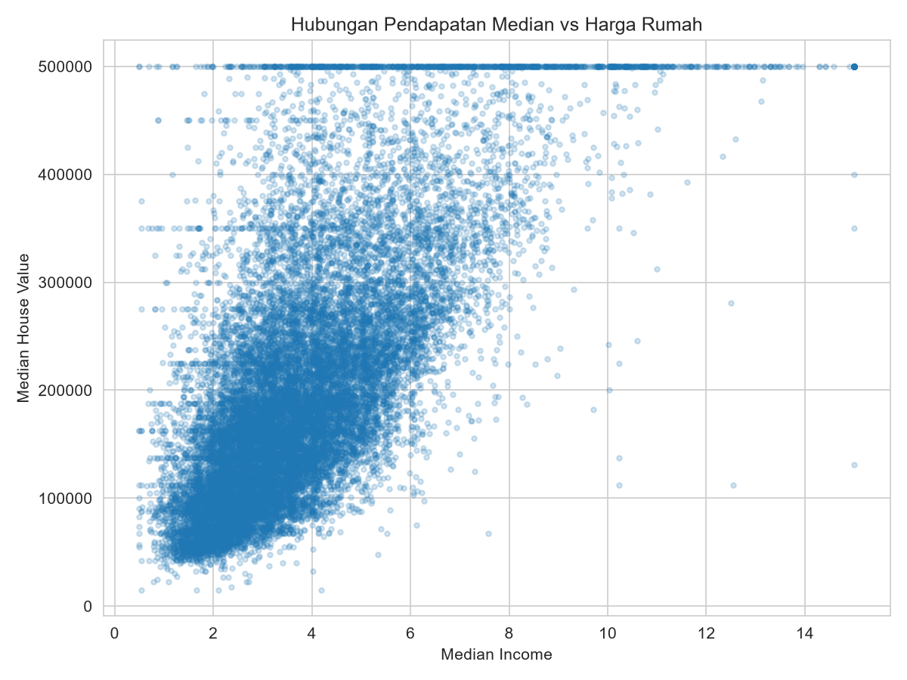
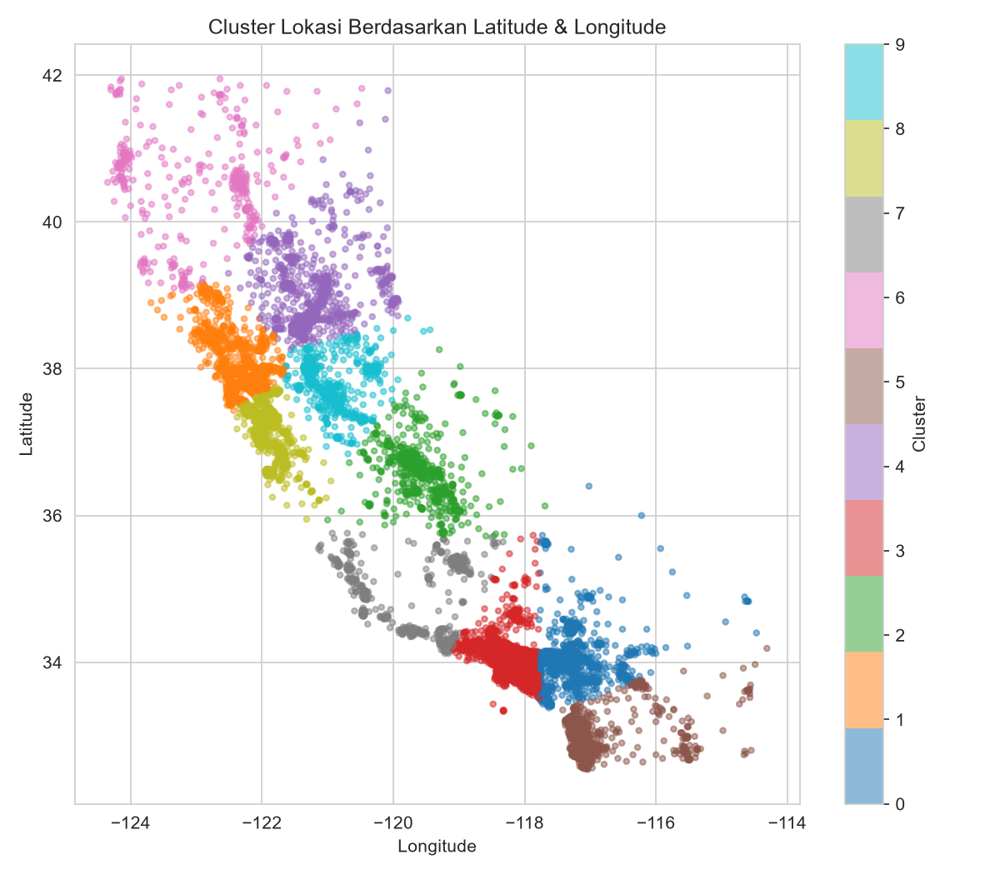

# 🏡 California Housing Price Analysis

Analisis eksploratif dataset **California Housing** untuk mengidentifikasi faktor-faktor yang paling memengaruhi harga rumah, menggunakan Python, Pandas, Seaborn, dan Scikit-learn.

## 📌 Ringkasan

| | |
|---|---|
| **Jumlah data** | 20.640 baris × 10 kolom |
| **Target** | `median_house_value` |
| **Prediktor terkuat** | `median_income` (r = 0.69) |
| **Missing values** | 207 baris pada `total_bedrooms` (diimputasi dengan median) |

## 🔍 Alur Analisis

1. **Data Loading** — memuat dataset dengan Pandas
2. **Data Inspection** — `.head()`, `.describe()`, `.info()` untuk memahami struktur data
3. **Missing Value Handling** — deteksi via `.isnull().sum()`, imputasi dengan median
4. **Exploratory Visualization** — heatmap korelasi (`sns.heatmap`) dan `sns.pairplot` untuk melihat hubungan antar fitur
5. **Feature Engineering**:
   - `rooms_per_household` — rata-rata kamar per rumah tangga
   - `bedrooms_per_room` — proporsi kamar tidur terhadap total kamar
   - `population_per_household` — kepadatan penghuni per rumah tangga
   - `location_cluster` — klaster wilayah dari `latitude`/`longitude` via KMeans

## 📊 Temuan Utama

- **Pendapatan median warga (`median_income`) adalah prediktor terkuat** terhadap harga rumah (korelasi 0.69), jauh di atas fitur lain.
- **Populasi dan jumlah kamar tidur mentah hampir tidak berkorelasi langsung** dengan harga — sinyalnya baru muncul setelah diubah jadi rasio.
- **`bedrooms_per_room` berkorelasi negatif** (r ≈ -0.23) — proporsi kamar tidur yang lebih tinggi cenderung menandakan rumah yang lebih murah.
- Ditemukan **capping harga di ~$500.000** pada data target, kemungkinan artefak dari proses pengumpulan data.
- Lokasi (lewat klaster latitude/longitude) menangkap efek geografis yang tidak terlihat dari fitur numerik mentah.

## 🗺️ Interpretasi Cluster Lokasi

`location_cluster` dibentuk dari 10 klaster KMeans atas `latitude` & `longitude`. Statistik tiap cluster dihitung langsung di `analisis_housing.py` (lihat blok "Statistik ringkasan per cluster lokasi") dan disimpan sebagai `cluster_summary.csv` — jadi angka di tabel ini bisa direproduksi ulang dari skrip, bukan diketik manual.

| Cluster | Wilayah (perkiraan) | Jumlah rumah | Harga rata-rata | Income rata-rata | Dominan |
|---|---|---|---|---|---|
| 8 | South Bay / Silicon Valley (San Jose) | 1.769 | $288.115 | 5.01 | <1H OCEAN |
| 1 | East/North Bay (Oakland–San Francisco) | 3.153 | $243.996 | 4.10 | NEAR BAY |
| 3 | Los Angeles Metro | 7.269 | $242.197 | 4.10 | <1H OCEAN |
| 7 | Santa Barbara–Ventura (pesisir) | 939 | $192.464 | 3.47 | NEAR OCEAN |
| 5 | San Diego | 1.809 | $184.881 | 3.66 | NEAR OCEAN |
| 0 | Inland Empire (Riverside–San Bernardino) | 1.756 | $159.865 | 3.85 | INLAND |
| 4 | Sacramento | 1.471 | $127.205 | 3.17 | INLAND |
| 9 | Central Valley Utara (Stockton–Modesto) | 989 | $120.830 | 3.01 | INLAND |
| 6 | California Utara Jauh (Redding–Humboldt) | 472 | $88.926 | 2.48 | INLAND |
| 2 | Central Valley Selatan (Fresno–Bakersfield) | 1.013 | $84.388 | 2.80 | INLAND |

Nama wilayah diperkirakan dari rata-rata latitude/longitude tiap cluster, bukan hasil reverse-geocoding presisi.

**Pola yang terlihat:**
- Cluster di sekitar Bay Area & LA (8, 1, 3) punya harga rumah **dan** pendapatan tertinggi — sejalan dengan `median_income` sebagai prediktor terkuat.
- Cluster inland/Central Valley (2, 6, 9, 4) konsisten punya harga terendah, cocok dengan `ocean_proximity` dominan "INLAND".
- Cluster pesisir non-Bay/LA (5, 7) berada di tengah — dekat laut tapi bukan pusat ekonomi utama.

## 🖼️ Visualisasi

| Heatmap Korelasi | Income vs Harga Rumah | Klaster Lokasi |
|---|---|---|
|  |  |  |

## 🛠️ Tech Stack

- Python 3
- Pandas, NumPy
- Seaborn, Matplotlib
- Scikit-learn (KMeans)

## 🚀 Cara Menjalankan

```bash
git clone https://github.com/<username>/california-housing-analysis.git
cd california-housing-analysis
pip install pandas numpy seaborn matplotlib scikit-learn
python analisis_housing.py
```

Skrip akan menghasilkan:
- `heatmap_korelasi.png`
- `pairplot_fitur_kunci.png`
- `scatter_income_vs_price.png`
- `cluster_lokasi.png`
- `housing_processed.csv` (dataset hasil pemrosesan & feature engineering)
- `cluster_summary.csv` (statistik ringkasan per cluster lokasi — sumber tabel interpretasi cluster di atas)

## 📂 Struktur Repo

```
├── housing.csv                 # dataset mentah
├── analisis_housing.py         # skrip analisis lengkap
├── housing_processed.csv       # output: dataset setelah cleaning & feature engineering
├── cluster_summary.csv         # output: statistik ringkasan per cluster lokasi
├── heatmap_korelasi.png        # output: visualisasi
├── pairplot_fitur_kunci.png    # output: visualisasi
├── scatter_income_vs_price.png # output: visualisasi
├── cluster_lokasi.png          # output: visualisasi
└── README.md
```

## 📈 Next Steps

Langkah lanjutan yang bisa ditambahkan: modeling prediktif (Linear Regression, Random Forest, atau Gradient Boosting) untuk memprediksi `median_house_value` menggunakan fitur hasil rekayasa di atas.

## 📄 Lisensi

Dataset California Housing bersumber dari [StatLib repository](http://lib.stat.cmu.edu/datasets/) / tersedia publik lewat Scikit-learn dan Kaggle.
